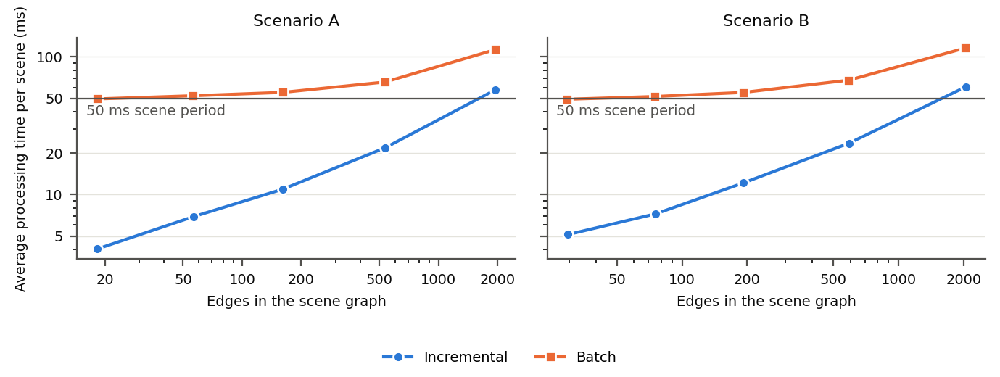
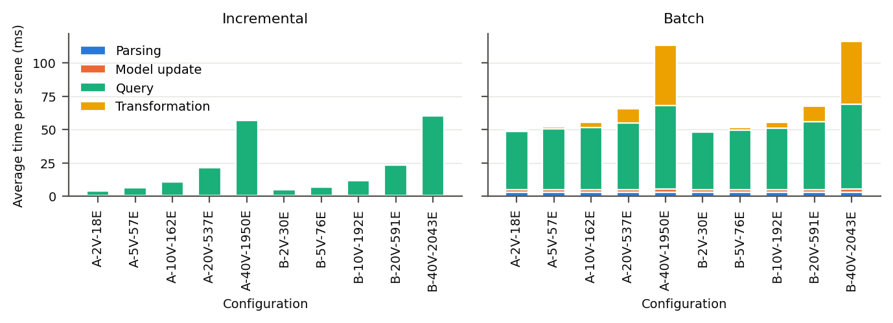

# Replication package
**For the paper _Real-time Safety Analysis of Driving Scenes by Incremental Model Transformations over Scene Graphs_.**

## About

Real-time safety analysis of autonomous vehicles requires low-latency processing of continuously evolving driving environments. This is challenging because even small changes in the physical scene can alter multiple spatial and semantic relationships that must be updated and re-evaluated before safety conditions can be assessed.
In this work, we present a model-driven approach based on incrementally maintained scene graphs. Driving scenes are represented as typed scene graph models that are updated in place as new observations arrive. Incremental model transformations semantically enrich the scene graph and subsequently evaluate safety conditions, materializing detected violations as explicit model elements.
We implement the approach using EMF and VIATRA and demonstrate its utility with Responsibility-Sensitive Safety (RSS) conditions.
Our work demonstrates how model-driven engineering can bring structure, efficiency, and extensibility to real-time safety analysis in dynamic driving environments.

## Table of contents
- [Content description](#content-description)
- [Reproduction of analysis](#reproduction-of-analysis)
- [Reproduction of experimental data](#reproduction-of-experimental-data)
- [Experiment settings](#experiment-settings)
- [Results](#results)

## Content description

`01-configurations`: contains the CARLA configuration artifacts
- `paper_lead_brake_town06.json`: Scenario A (the lead vehicle brakes), made with the CARLA Scenario Editor ([Bozkurt et al., MODELS 2026](https://doi.org/10.1145/3837062.3838882))
- `paper_cut_in_town06.json`: Scenario B (a vehicle cuts in), made with the CARLA Scenario Editor
- `evaluation.json`: the scene rate, external vehicle counts, runs, strategies, and simulation settings
- `run_experiments.ps1`: runs the simulations and the analysis pipeline, and writes `02-data`

`02-data`: contains the simulation data produced by `run_experiments.ps1`. A simulation run is named by its scenario, external vehicle count, seed, and strategy. The seed is the integer that initializes the random number generator of `scenario_evaluation.py` (Python's `random.Random(seed)`), which picks each external vehicle's lane, position, and model, and each lane's speed (see [Reproducibility](#reproducibility)).
- `measurements/<scenario>-<external vehicles>-<seed>-<strategy>.csv`: 1 row per scene, see [Measurements](#measurements)
- `scenes/<scenario>-<external vehicles>-<seed>-<strategy>.jsonl.gz`: the scene updates the scene extractor sent, 1 JSON update message per line
- `scenes/<scenario>-<external vehicles>-<seed>-<strategy>.jsonl.meta.json`: the summary of the simulation run

`03-analysis`: contains the Python script that produces `04-results` from `02-data`

`04-results`: contains the plots, statistics, and tables used in the publication
- `plots/`: average processing time per scene against edges, and average time per stage
- `statistics/`: `summary.csv`, the averages per configuration and strategy, and `scene_check.csv`, whether both strategies received the same scenes for each seed
- `tables/`: the LaTeX tables of average processing time and average time per stage

## Reproduction of analysis

### Requirements

Python 3.10 or higher is required. Set up a virtual environment from the `03-analysis` directory:

```powershell
cd 03-analysis
python -m venv .venv
.venv\Scripts\activate
pip install -r requirements.txt
```

### Step 1: Analysis

```powershell
python analyze.py
```

This will:
1. Read the measurements in `02-data` and check that each run measured every scene it sent
2. Average every scene from `warmup_s` into each run per configuration and strategy, and save the averages to `04-results/statistics/summary.csv`
3. Check that both strategies received the same scenes for each seed, and save the result to `04-results/statistics/scene_check.csv`
4. Save the tables to `04-results/tables/` and the plots to `04-results/plots/`

A configuration is labelled by its scenario, external vehicles (V), and average number of edges in the scene graph (E). For example, `A-40V-1950E` is Scenario A with 40 external vehicles, in which the scene graph has 1950 edges on average. The processing time of a scene is the sum of its 4 stages, so the 4 stage averages add up to the average processing time.

> **`--data`** and **`--results`**: read from and write to other directories. The data directory follows the layout of `02-data`.

### Measurements

Each row of a measurement file is 1 scene. Times are in milliseconds.

| Column | Meaning |
|---|---|
| `tick` | The scene's number in the run, starting at 1. The first scene also holds the map. |
| `sent_ms` | When the scene extractor sent the scene update, epoch time |
| `received_ms` | When the scene update arrived at the analysis pipeline, epoch time |
| `parse_ms` | Parsing time. For the batch strategy, it includes creating the empty scene graph. |
| `update_ms` | Model update time |
| `query_ms` | Query time: propagating the update (incremental), or building every query's matches over the new scene graph (batch) |
| `transformation_ms` | Transformation time, until no rule is left to fire |
| `total_ms` | Processing time, from the scene's arrival until all triggered transformations have completed |
| `vertices`, `vehicles` | Vertices in the scene graph after the scene, and the vehicles among them |
| `edges` | Edges in the scene graph after the scene |
| `distance`, `spatial`, `lane`, `rss_longitudinal`, `rss_lateral` | Edges by type |

## Reproduction of experimental data

### Setting up mt4sg

For the following steps, refer to the tool's [code repository](https://www.mcscert.ca/gitlab/rss/mt4sg) at commit `b06b753` and its `QUICKSTART.md`.
- Import mt4sg into Eclipse with VIATRA 2.9.1 and build it, so that each plug-in's classes are in its `bin` folder.
- Set up the Python environment in `mt4sg\carla\.venv` with the CARLA client and pyzmq.
- Start CARLA 0.9.16 (`CarlaUE4.exe`, port 2000).

The scenario files run without the CARLA Scenario Editor installed.

### Step 0: Configuration files

The simulation runs are controlled by `01-configurations/evaluation.json`:

| Key | Meaning |
|---|---|
| `scene_rate_hz` | Scene updates per second. CARLA steps by 1 period per scene. |
| `scenarios` | The scenario files, by key. The key names the runs, such as `a` in `a-40-3-incremental.csv`. |
| `external_vehicles` | The external vehicle counts |
| `runs_per_count` | Valid runs per scenario and external vehicle count, with the seeds 1, 2, 3, and so on |
| `strategies` | `incremental`, `batch`, or both |
| `warmup_s` | Time at the start of each run that `analyze.py` leaves out of the averages |
| `context_s` | Time a run continues after the vehicles of the scenario settle |
| `timeout_s` | Longest run. A run that reaches it is invalid. |
| `ego_response_s` | Time between the vehicle ahead of the ego vehicle starting to stop and the ego vehicle braking |
| `external_min_gap_m` | Smallest distance between 2 external vehicles in a lane, centre to centre |
| `external_speed_spread` | Largest relative difference between the speed of an external vehicle's lane and the ego vehicle's target speed |

> **To run other scenarios**, save them from the CARLA Scenario Editor (schema version 3) into `01-configurations` and add them to `scenarios`. The scenario has to take place on a straight road. External vehicles are placed in the lanes the scenario doesn't use.

### Step 1: Simulation runs

```powershell
cd 01-configurations
.\run_experiments.ps1 -Mt4sg <path to mt4sg> -EclipsePlugins <path to Eclipse>\plugins
```

For each scenario, external vehicle count, seed, and strategy, this will:
1. Start the analysis pipeline (`ca.mcmaster.mt4sg.core.runner.Evaluation`) with the strategy, subscribed to the scene extractor over ZeroMQ
2. Play the scenario file in CARLA with `mt4sg\carla\src\scenario_evaluation.py`, which places the external vehicles for the seed and sends a scene update every 50 ms
3. Check that the analysis pipeline measured every scene update sent
4. Save the measurements and scene updates to `02-data`

> A run is invalid if a vehicle of the scenario is more than 0.5 km/h off its speed when the first step changes, an external vehicle fails to spawn, a vehicle of the scenario collides, an external vehicle enters a lane of the scenario, or the run reaches the 12 s timeout. The script then runs the next seed, until each scenario and external vehicle count has 6 valid runs. In `02-data`, the seeds 1 to 6 gave a valid run for every scenario and external vehicle count.
>
> The script resumes where it stopped. The 120 runs take about 45 minutes.

### Reproducibility

A seed determines its run. CARLA runs in synchronous mode with a fixed step, `scenario_evaluation.py` controls every vehicle without CARLA's Traffic Manager, and the seed is the only source of randomness. With the versions in `REQUIREMENTS.md`, running a seed again sends the same scene updates, apart from their send timestamps, so the scene graphs and their vertex and edge counts are the same. The 2 strategies of a seed are separate simulation runs, and `04-results/statistics/scene_check.csv` shows that their scene updates are identical for all 60 seeds.

The processing times are measured on the machine that runs the analysis pipeline, so they differ between machines and between runs. `analyze.py` reproduces the statistics, tables, and plots in `04-results` exactly from `02-data`.

## Experiment settings

### Scenarios

Both scenarios take place on CARLA's Town06 map, on a highway with 5 lanes in the direction of travel, at x = 250 m, y = 144 m. Every lane runs straight from 230 m behind the ego vehicle to 390 m ahead.

**Scenario A: The lead vehicle brakes.** The ego vehicle follows the lead vehicle in the same lane, 35 m behind it bumper to bumper. Both vehicles travel at 60 km/h. 4 s into the run, the lead vehicle brakes at its maximum braking rate. The ego vehicle brakes at its maximum braking rate 0.5 s later, the RSS response time ρ. Both vehicles stop 23.9 m apart.

**Scenario B: A vehicle cuts in.** The ego vehicle follows the lead vehicle as in Scenario A. A third vehicle starts in the lane left of the ego vehicle, 6.2 m behind it centre to centre, at 70 km/h. 4 s into the run, its rear is level with the ego vehicle's front, and it changes into the ego vehicle's lane. It ends 14.7 m ahead of the ego vehicle bumper to bumper, inside the RSS safe distance of 27.5 m.

Each run ends 2 s after the vehicles of the scenario settle: 8.8 s into the run in Scenario A, 9.4 s in Scenario B.

### Settings and parameters

| Parameter | Value |
|---|---|
| Simulator | CARLA 0.9.16 in synchronous mode, fixed step of 0.05 s |
| Scene rate | 20 Hz |
| Vehicle models | Ego vehicle: `vehicle.lincoln.mkz_2020`. Lead and third vehicle: `vehicle.dodge.charger_2020` |
| Speed control | Velocity set at every scene, steering along the lane by pure pursuit (Coulter, 1992) |
| External vehicles | 2, 5, 10, 20, 40 |
| External vehicle lanes | The other lanes in the direction of travel: 4 in Scenario A, 3 in Scenario B |
| External vehicle positions | Random, from 230 m behind to 170 m ahead of the ego vehicle, at least 8 m apart centre to centre within a lane |
| External vehicle speeds | 1 random speed per lane, 60 km/h ± 10% |
| External vehicle models | Random, among CARLA's 4 wheeled vehicles |
| Randomness | `random.Random(seed)` in `scenario_evaluation.py`, for the external vehicle positions, speeds, and models |
| Strategies | Incremental, batch |
| Runs | Seeds 1 to 6 per scenario, external vehicle count, and strategy: 120 runs |
| Run length | Until 2 s after the vehicles of the scenario settle, with a 12 s timeout |
| Warm up | Measurement starts 2 s into each run |
| JVM | 1 per run, `-Xmx8g` |
| Logging | Log output of the analysis pipeline off. mt4sg's ZeroMQ bridge prints each scene update before the arrival timestamp. |

## Results

### Average processing time per scene



### Average time per stage


