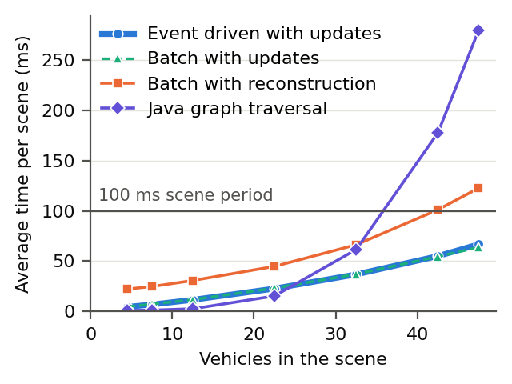
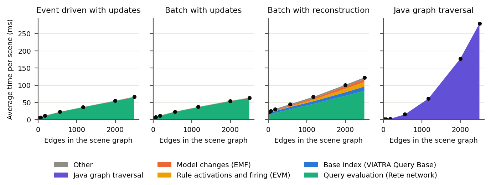

# Replication package
**For the paper _Real-time Safety Monitoring of Autonomous Vehicles by Incremental Model Transformations over Scene Graphs_.**

## About

Real-time safety monitoring of autonomous vehicles requires low-latency processing of continuously evolving driving environments. This is challenging because even small changes in the physical scene can alter multiple spatial and semantic relationships that must be updated and re-evaluated before safety conditions can be assessed.
In this work, we present a model-driven approach based on incrementally maintained scene graphs. Driving scenes are represented as typed scene graph models that are updated in place as new observations arrive. Incremental model transformations semantically enrich the scene graph and subsequently evaluate safety conditions, materializing detected violations as explicit model elements.
We implement the approach using EMF and VIATRA and demonstrate its utility with monitoring Responsibility-Sensitive Safety (RSS) conditions.
Our work demonstrates how model-driven engineering can bring structure, efficiency, and extensibility to real-time safety monitoring of autonomous vehicles.

## Quick start

This repository holds the paper's data, experiments, and analysis. To use the tool itself rather than reproduce the paper, start at MT4SG.

Pick what you want to do:

| You want to | You need | It takes |
|---|---|---|
| [Rebuild the paper's tables and figures](#reproduction-of-analysis) from the recorded data | Python | 1 minute |
| [Check your setup](#step-1-check-your-setup) with 1 short configuration | The tool and CARLA | 2 minutes |
| [Run all 336 simulations again](#step-2-simulation-runs) | The tool and CARLA | About 2 hours |
| [Profile the recorded runs again](#step-3-profiling) | The tool | About 1 hour |

To rebuild the tables and figures, clone this repository and run this from it:

```powershell
cd 03-analysis
python -m venv .venv
.venv\Scripts\activate
pip install -r requirements.txt
python analyze.py
```

The results appear in `04-results`, and they're identical to the ones in this repository.

## Table of contents
- [Quick start](#quick-start)
- [Content description](#content-description)
- [Reproduction of analysis](#reproduction-of-analysis)
- [Reproduction of experimental data](#reproduction-of-experimental-data)
- [Experiment settings](#experiment-settings)
- [Results](#results)

## Content description

`01-configurations`: contains the CARLA configuration artifacts and the evaluation code
- `paper_lead_brake_town06.json`: Scenario A (the lead vehicle brakes), made with the CARLA Scenario Editor ([Bozkurt et al., MODELS 2026](https://doi.org/10.1145/3837062.3838882))
- `paper_cut_in_town06.json`: Scenario B (a vehicle cuts in), made with the CARLA Scenario Editor
- `evaluation.json`: the scene rate, external vehicle counts, runs, strategies, and simulation settings
- `evaluation-quick.json`: the same settings for 1 short configuration, to check a setup
- `ca.mcmaster.mt4sg.evaluation/`: the Eclipse plug-in that runs the analysis pipeline with each strategy and measures every scene, see [Strategies](#strategies)
- `scenario_evaluation.py`: plays a scenario file in CARLA with the external vehicles of a seed, and sends a scene update every 100 ms
- `run_experiments.ps1`: runs the simulations and the analysis pipeline, and writes `rerun/data`
- `run_profiles.ps1`: replays the recorded runs of a scenario through the analysis pipeline with Java Flight Recorder, and writes `rerun/data/profile`
- `profile_replay.py`: sends the recorded scene updates of a run to the analysis pipeline for `run_profiles.ps1`
- `component_samples.py`: counts the profiler samples of each component for `run_profiles.ps1`

`02-data`: contains the recorded simulation data and profiler samples of the paper. A simulation run is named by its scenario, external vehicle count, seed, and strategy. The seed is the integer that initializes the random number generator of `scenario_evaluation.py` (Python's `random.Random(seed)`), which picks each external vehicle's lane, position, and model, and each lane's speed (see [Reproducibility](#reproducibility)).
- `measurements/<scenario>-<external vehicles>-<seed>-<strategy>.csv`: 1 row per scene, see [Measurements](#measurements)
- `scenes/<scenario>-<external vehicles>-<seed>-<strategy>.jsonl.gz`: the scene updates the scene extractor sent, 1 JSON update message per line
- `scenes/<scenario>-<external vehicles>-<seed>-<strategy>.jsonl.meta.json`: the summary of the simulation run
- `profile/component_samples.csv`: the profiler samples per component of the runs of Scenario A, see [Processing time per component](#processing-time-per-component)

`03-analysis`: contains the Python script that produces `04-results` from `02-data`

`04-results`: contains the plots, statistics, and tables used in the publication
- `plots/`: average processing time per scene against edges, vehicles, and nodes, and average time per component
- `statistics/`: `summary.csv`, the averages per configuration and strategy, and `scene_check.csv`, whether every strategy received the same scenes for each seed
- `tables/`: the LaTeX tables of average processing time and average time per stage

## Reproduction of analysis

### Requirements

Python 3.10 or higher is required. Set up a virtual environment from the `03-analysis` directory:

```powershell
cd 03-analysis
python -m venv .venv
.venv\Scripts\activate
pip install -r requirements.txt
```

### Step 1: Analysis

```powershell
python analyze.py
```

This will:
1. Read the measurements in `02-data` and check that each run measured every scene it sent
2. Average every scene from `warmup_s` into each run per configuration and strategy, and save the averages to `04-results/statistics/summary.csv`
3. Check that every strategy received the same scenes for each seed, and save the result to `04-results/statistics/scene_check.csv`
4. Save the tables to `04-results/tables/` and the plots to `04-results/plots/`, with the time per component from `02-data/profile/component_samples.csv`

A configuration is labelled by its scenario, external vehicles (V), and average number of edges in the scene graph (E). For example, `A-40V-1945E` is Scenario A with 40 external vehicles, in which the scene graph has 1945 edges on average. The processing time of a scene is the sum of its 4 stages, so the 4 stage averages add up to the average processing time.

> **`--data`**, **`--results`**, **`--config`**, and **`--profile`**: read from and write to other directories and files. The data directory follows the layout of `02-data`.

### Measurements

Each row of a measurement file is 1 scene. Times are in milliseconds.

| Column | Meaning |
|---|---|
| `tick` | The scene's number in the run, starting at 1. The first scene also holds the map. |
| `sent_ms` | When the scene extractor sent the scene update, epoch time |
| `received_ms` | When the scene update arrived at the analysis pipeline, epoch time |
| `parse_ms` | Parsing time |
| `update_ms` | Model update time. For `batch`, it includes building the new scene graph and putting it in place of the old one. |
| `query_ms` | Query time: the model update reaching the query results in the Rete network. 0 for `java-traversal`, which has no query engine. |
| `transformation_ms` | Transformation time, until no rule is left to fire. For `java-traversal`, the time of its loops. |
| `total_ms` | Processing time, from the scene's arrival until all triggered transformations have completed |
| `vertices`, `vehicles` | Vertices in the scene graph after the scene, and the vehicles among them |
| `edges` | Edges in the scene graph after the scene |
| `distance`, `spatial`, `lane`, `rss_longitudinal`, `rss_lateral` | Edges by type |

### Processing time per component

`02-data/profile/component_samples.csv` holds the Java Flight Recorder samples of every run of Scenario A, replayed from its recorded scene updates at 10 Hz through the same analysis pipeline. 1 row is a run's scenario, external vehicle count, strategy, and component, with its number of samples, so each combination has 1 row per seed. Only samples inside the processing of a scene, from `warmup_s` into the run, count. `run_profiles.ps1` produces the file, see [Step 3: Profiling](#step-3-profiling).

A sample goes to the component of its innermost frame that belongs to one:

| Component | Code |
|---|---|
| Rete network | `org.eclipse.viatra.query.runtime` and the generated query classes |
| VIATRA Query Base | `org.eclipse.viatra.query.runtime.base` and `org.eclipse.viatra.query.runtime.emf` |
| EVM | `org.eclipse.viatra.transformation` |
| EMF | `org.eclipse.emf`, and VIATRA's model manipulation |
| Java graph traversal | `ca.mcmaster.mt4sg.evaluation.JavaGraphTraversal` |

EMF code that the query engine runs for its own work goes to the query engine's component. `analyze.py` counts every other sample as Other, and gives each component its share of the samples times the average processing time per scene.

## Reproduction of experimental data

### Setting up

1. Follow steps 1 to 4 of `QUICKSTART.md` in mt4sg. They put mt4sg, Carla2Ecore, CARLA, and Eclipse with VIATRA into a folder named `mt4sg-tools`.
2. Clone this repository into the same folder. The scripts find everything else there:
   ```
   mt4sg-tools\
       mt4sg\
       carla2ecore\
       eclipse\
       mt4sg-replication-package\
   ```
3. In Eclipse, choose **File > Import > General > Existing Projects into Workspace**, pick `mt4sg-tools\mt4sg-replication-package`, and click **Finish**. This adds the project `ca.mcmaster.mt4sg.evaluation`, and Eclipse compiles it into its `bin` folder.

For simulation runs, also:
- Start CARLA with `mt4sg\carla\CARLA_0.9.16\CarlaUE4.exe -RenderOffScreen`. Rendering off screen keeps the CARLA window from loading the machine that measures the processing times. If you run into an out of video memory error when starting CARLA, add the `-dx11` flag to the command.
- Switch Windows to the High performance power plan (`powercfg /setactive SCHEME_MIN`). On the Balanced plan, the processing times depend on Windows' power management.

The scenario files run without the CARLA Scenario Editor installed.

New runs go to the folder `rerun`, so `02-data` stays as recorded.

### Step 0: Configuration files

The simulation runs are controlled by `01-configurations/evaluation.json`:

| Key | Meaning |
|---|---|
| `scene_rate_hz` | Scene updates per second. CARLA steps by 1 period per scene. |
| `scenarios` | The scenario files, by key. The key names the runs, such as `a` in `a-40-3-incremental.csv`. |
| `external_vehicles` | The external vehicle counts |
| `runs_per_count` | Valid runs per scenario and external vehicle count, with the seeds 1, 2, 3, and so on |
| `strategies` | Any of `incremental`, `batch-update`, `batch`, and `java-traversal`, see [Strategies](#strategies) |
| `warmup_s` | Time at the start of each run that `analyze.py` leaves out of the averages |
| `context_s` | Time a run continues after the vehicles of the scenario settle |
| `timeout_s` | Longest run. A run that reaches it is invalid. |
| `ego_response_s` | Time between the vehicle ahead of the ego vehicle starting to stop and the ego vehicle braking |
| `external_min_gap_m` | Smallest distance between 2 external vehicles in a lane, centre to centre |
| `external_speed_spread` | Largest relative difference between the speed of an external vehicle's lane and the ego vehicle's target speed |

### Step 1: Check your setup

```powershell
cd 01-configurations
.\run_experiments.ps1 -Config evaluation-quick.json
```

This runs Scenario A with 2 external vehicles through all 4 strategies, and ends with:

```
[runs] a-2-1 java-traversal done
[runs] scenario a, 2 external vehicles: 1 valid seeds
```

### Step 2: Simulation runs

```powershell
cd 01-configurations
.\run_experiments.ps1
```

For each scenario, external vehicle count, seed, and strategy, this will:
1. Start the analysis pipeline (`ca.mcmaster.mt4sg.evaluation.Evaluation`) with the strategy, subscribed to the scene extractor over ZeroMQ
2. Play the scenario file in CARLA with `scenario_evaluation.py`, which places the external vehicles for the seed and sends a scene update every 100 ms
3. Check that the analysis pipeline measured every scene update sent
4. Save the measurements and scene updates to `rerun/data`

Runs that are already in `rerun/data` are skipped, so the script resumes where it stopped. To analyze the new runs:

```powershell
cd ..\03-analysis
python analyze.py --data ..\rerun\data --results ..\rerun\results
```

### Step 3: Profiling

```powershell
cd 01-configurations
.\run_profiles.ps1
```

For each run of Scenario A in `02-data/measurements`, this will:
1. Start the analysis pipeline with the run's strategy under Java Flight Recorder, which samples the running code every 1 ms (`ca.mcmaster.mt4sg.evaluation.ProfileMain`)
2. Replay the run's recorded scene updates from `02-data/scenes` with `profile_replay.py`, 1 every 100 ms on average, with each interval varying by up to 10 ms so the scenes don't arrive in step with the samples
3. After the last run, count each component's samples with `component_samples.py` and save them to `rerun/data/profile/component_samples.csv`

CARLA isn't needed for this step. The recordings take about 2 MB per run in `%TEMP%\mt4sg-profile`, and `-Scenario` profiles another scenario. To use the new samples:

```powershell
cd ..\03-analysis
python analyze.py --profile ..\rerun\data\profile\component_samples.csv --results ..\rerun\results
```

### Reproducibility

A seed determines its run. CARLA runs in synchronous mode with a fixed step, `scenario_evaluation.py` controls every vehicle without CARLA's Traffic Manager, and the seed is the only source of randomness. With the versions in `REQUIREMENTS.md`, running a seed again sends the same scene updates, apart from their send timestamps, so the scene graphs and their vertex and edge counts are the same. The 4 strategies of a seed are separate simulation runs, and `04-results/statistics/scene_check.csv` shows that their scene updates are identical for all 84 seeds.

The processing times are measured on the machine that runs the analysis pipeline, so they differ between machines and between runs. `analyze.py` reproduces the statistics, tables, and plots in `04-results` exactly from `02-data`.

## Experiment settings

### Scenarios

Both scenarios take place on CARLA's Town06 map, on a highway with 5 lanes in the direction of travel, at x = 250 m, y = 144 m. Every lane runs straight from 230 m behind the ego vehicle to 390 m ahead.

**Scenario A: The lead vehicle brakes.** The ego vehicle follows the lead vehicle in the same lane, 35 m behind it bumper to bumper. Both vehicles travel at 60 km/h. 4 s into the run, the lead vehicle brakes at its maximum braking rate. The ego vehicle brakes at its maximum braking rate 0.5 s later, the RSS response time ρ. Both vehicles stop 23.9 m apart.

**Scenario B: A vehicle cuts in.** The ego vehicle follows the lead vehicle as in Scenario A. A third vehicle starts in the lane left of the ego vehicle, 6.2 m behind it centre to centre, at 70 km/h. 4 s into the run, its rear is level with the ego vehicle's front, and it changes into the ego vehicle's lane. It ends 14.7 m ahead of the ego vehicle bumper to bumper, inside the RSS safe distance of 27.5 m.

Each run ends 2 s after the vehicles of the scenario settle: 8.8 s into the run in Scenario A, 9.4 s in Scenario B.

### Strategies

The 4 strategies derive the same edges on the same scene graph metamodel. The key in parentheses names the strategy in `evaluation.json` and in the file names.

| Strategy | Scene graph | Query results | Rules |
|---|---|---|---|
| Event driven with updates (`incremental`) | 1 scene graph, updated by each scene update | 1 VIATRA query engine per run, whose Rete network updates the query results | Fired by VIATRA's event-driven transformation when the query results change |
| Batch with updates (`batch-update`) | 1 scene graph, updated by each scene update | 1 query engine per run, as above | Fired explicitly by a VIATRA batch transformation until none can fire |
| Batch with reconstruction (`batch`) | A new scene graph built from the complete scene for every scene, put in place of the old one | 1 query engine per run, which removes the matches of the old scene graph and computes those of the new one | As in batch with updates, creating every edge again |
| Java graph traversal (`java-traversal`) | 1 scene graph, updated by each scene update | No query engine. Plain Java loops check every pair of vehicles, and every vehicle and lane segment, again | The loops create, relabel, or remove the edges whose relation changed |

The 3 VIATRA strategies delay the query result updates until the whole scene update is applied.

### Settings and parameters

| Parameter | Value |
|---|---|
| Simulator | CARLA 0.9.16 in synchronous mode, fixed step of 0.1 s, rendering off screen |
| Scene rate | 10 Hz |
| Vehicle models | Ego vehicle: `vehicle.lincoln.mkz_2020`. Lead and third vehicle: `vehicle.dodge.charger_2020` |
| Speed control | Velocity set at every scene, steering along the lane by pure pursuit (Coulter, 1992) |
| External vehicles | 2, 5, 10, 20, 30, 40, 45 |
| External vehicle lanes | The other lanes in the direction of travel: 4 in Scenario A, 3 in Scenario B |
| External vehicle positions | Random, from 230 m behind to 170 m ahead of the ego vehicle, at least 8 m apart centre to centre within a lane |
| External vehicle speeds | 1 random speed per lane, 60 km/h ± 10% |
| External vehicle models | Random, among CARLA's 4 wheeled vehicles |
| Randomness | `random.Random(seed)` in `scenario_evaluation.py`, for the external vehicle positions, speeds, and models |
| Strategies | Event driven with updates, batch with updates, batch with reconstruction, Java graph traversal |
| Runs | Seeds 1 to 6 per scenario, external vehicle count, and strategy: 336 runs |
| Run length | Until 2 s after the vehicles of the scenario settle, with a 12 s timeout |
| Warm up | Measurement starts 2 s into each run |
| JVM | 1 per run, `-Xmx8g` |
| Power plan | Windows High performance |
| Logging | Warnings only, so the analysis pipeline logs nothing while it processes a scene |

## Results

### Average processing time per scene




### Average time per component


